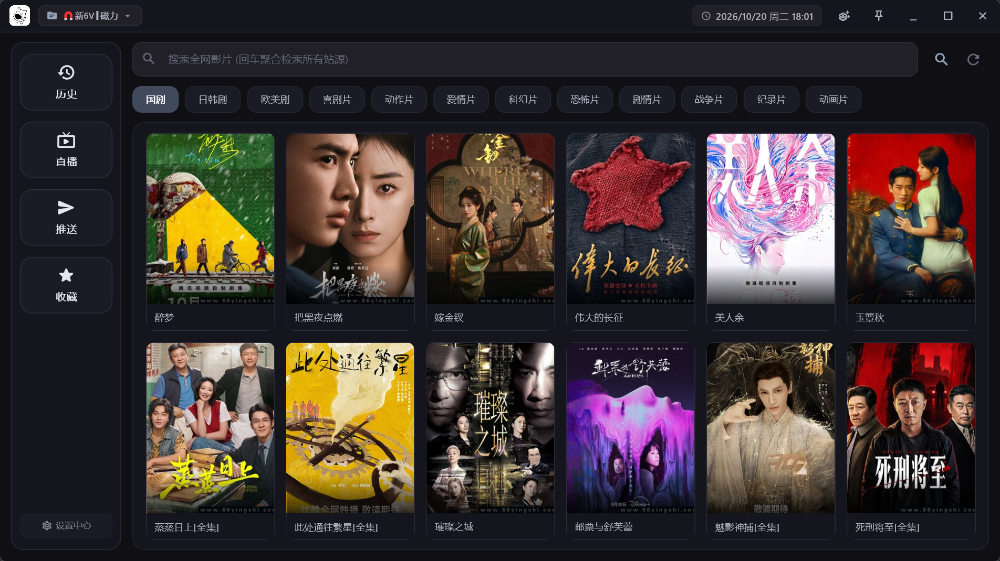
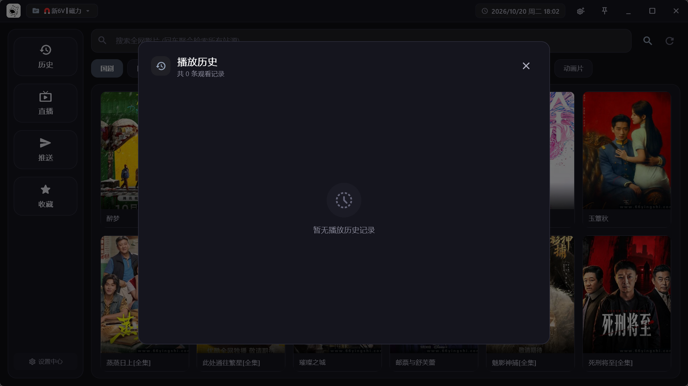
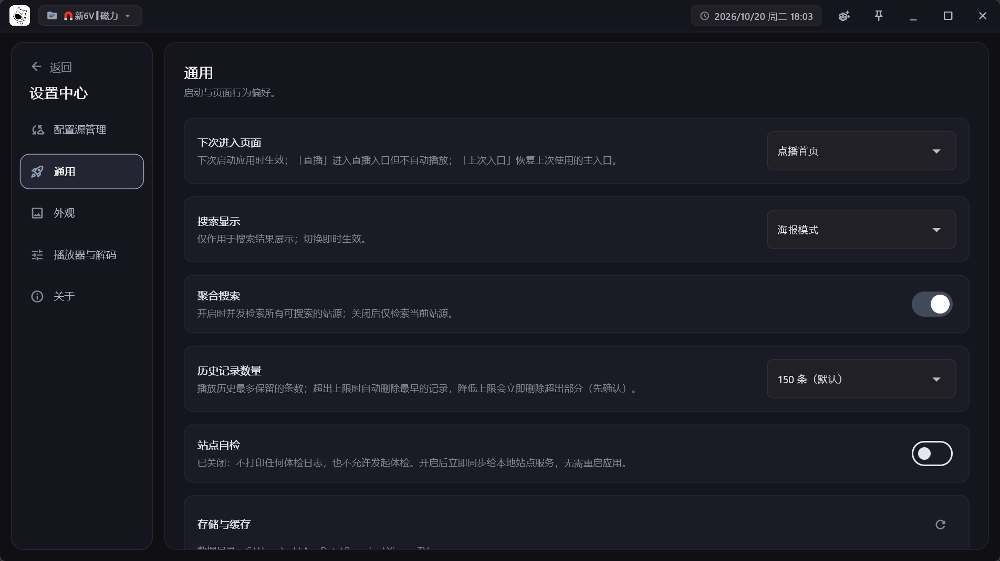

# 修狗TV（xiugou-tv）

一款面向 Windows 的桌面影视聚合播放客户端。

  

  
  
  

## 简介

修狗TV 是一款运行在 Windows 10/11 x64 上的桌面影视客户端。导入你自己的影视配置后，就可以在同一套界面里浏览分类、搜索剧集、选集播放，并随时切换到电视直播。

播放内核基于 libmpv（media_kit），提供硬件解码、多轨切换、倍速与断点续播。解析层内置 JVM 运行时，可直接运行既有生态的 spider 插件，因此你现有的站点配置基本可以原样复用。

软件本身不提供任何内容源，播放内容来自你自行添加的配置。

## 核心亮点

- 点播与直播共用一套界面：分类浏览、全局搜索、选集播放、频道切换与 EPG 节目单。
- libmpv 播放内核：D3D11VA / DXVA2 硬件解码，0.5–3.0 倍速，音轨 / 视轨 / 字幕轨切换。
- 直接复用既有影视配置与 spider 插件，无需迁移内容源。
- 播放失败自动换线，也可手动切线路；片头片尾可按时长跳过。
- 历史、收藏与各项偏好支持一键备份与恢复。

## 功能特性

### 内容源与配置

- 支持Tvbox影视配置 JSON、多仓清单与 CMS 资源站清单导入，多仓可指定具体仓库。
- 站点中的相对地址（api / ext / jar）自动还原，支持远程与本地文件。
- 站点自检：逐个体检站点，给出分类数量与可用性结论。

### 点播

- 首页分类浏览、海报瀑布流，站点与分类可快速切换。
- 全局搜索：输入即出增量结果，结果可按站点分组筛选。
- 详情页展示剧集信息、播放线路与选集列表，支持收藏。
- 播放历史与断点续播，保留条数可配置（10–9999）。

### 直播

- 支持 M3U / TXT 直播源导入，直播源独立于点播配置保存。
- 频道按来源分组，支持分组浏览与频道搜索。
- EPG 节目单：查看频道当前与后续节目。

### 播放器

- libmpv 内核，支持 D3D11VA、D3D11VA（拷回模式）、DXVA2 硬件解码，并显示硬解状态。
- 倍速 0.5–3.0，可调音量与画面缩放。
- 视频轨、音轨、字幕轨切换，支持关闭字幕。
- 片头 / 片尾跳过，按毫秒精确配置。
- 自动换线与手动换线，失败提示统一呈现。
- 键盘快捷键与鼠标操作并行。

### 界面与交互

- 左侧导航 + 顶部搜索 + 站点分类横滚 + 海报网格的桌面布局。
- 详情、选集、收藏、历史、直播频道与 EPG 以浮层呈现，不打断当前播放。
- 支持深色 / 浅色 / 跟随系统三档主题，可自定义壁纸。
- 记忆窗口大小与位置，并限制最小窗口尺寸。

### 媒体与数据

- 媒体直链、本地文件与 WebDAV 目录均可直接浏览播放（不支持磁力链）。
- 数据目录可自行指定并迁移，启动前校验写入权限。
- 备份与恢复覆盖历史、收藏与偏好设置，恢复后自动重启生效。

## 界面截图

### 首页

  

左侧导航 + 顶部搜索 + 站点分类横栏 + 海报网格；站点与分类都能一键切换。

### 播放历史

  

按时间倒序记录剧集与观看进度，点击即从上次位置续播；保留条数可配置（10–9999）。

### 设置

  

主题与壁纸、播放器、数据目录、站点自检与备份恢复集中在这里。

## 上游来源与致谢

本项目的产品形态与交互参考了 FongMi 系列（[FongMi/TV](https://github.com/FongMi/TV)）以及 TVBox / CatVod 生态的既有实现，解析层遵循 CatVod spider 契约，以便直接运行既有插件。感谢这些项目及其贡献者长期的开源工作。

播放基于 [media_kit](https://github.com/media-kit/media-kit)（libmpv）；部分兼容能力借助 [unidbg](https://github.com/zhkl0228/unidbg) 与 [dex2jar](https://github.com/pxb1988/dex2jar) 实现。

第三方组件的许可声明见各自 jar 包内附带的许可文件（`companion/lib`、`companion/lib-unidbg`、`companion/libs`）。

## 许可证

本项目以 GPL-3.0 协议发布，详见 [LICENSE](LICENSE)。
